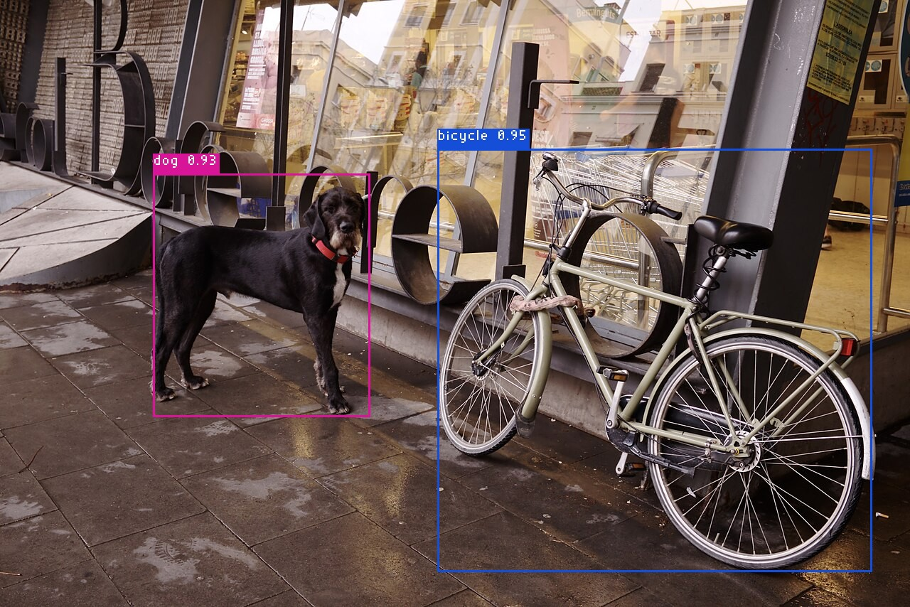

# Hello World Example

This walkthrough takes the official **YOLOX** object detector through the two OAAX stages and prints what it finds in a photo:

1. **Convert** the ONNX model with the chip's conversion toolchain (a Docker image).
2. **Run** the converted model with the chip's runtime library, through one small C host application.

The host is the same for every chip: only the runtime library and the converted model change. That is the point of OAAX.



*The picture the host writes. Photo: [Dog from Barcelona 01.jpg](https://commons.wikimedia.org/wiki/File:Dog_from_Barcelona_01.jpg){:target="_blank"} by Nicolas Vigier, [CC0 1.0](https://creativecommons.org/publicdomain/zero/1.0/){:target="_blank"}.*

## Requirements

- A Linux x86_64 machine (Ubuntu 22.04 or higher) with [Docker](https://docs.docker.com/engine/install/){:target="_blank"} that your user can run without `sudo`.
- [`uv`](https://docs.astral.sh/uv/getting-started/installation/){:target="_blank"}, which runs the OAAX tools: `curl -LsSf https://astral.sh/uv/install.sh | sh`, then `export PATH="$HOME/.local/bin:$PATH"`.
- Build tools: `sudo apt-get install -y git curl cmake build-essential libgomp1 ca-certificates zip` (`zip` is only needed for the Intel tab).
- For Intel GPU or NPU inference, the Intel drivers (see the [Intel page](Intel.md#installation)). The CPU device needs none.

## 1. Build the host and get the model

The [YOLOX example](https://github.com/OAAX-standard/examples/tree/main/yolox-example){:target="_blank"} is a C program that loads any OAAX 2.0 runtime, runs the model on an image, prints the detections and draws them. It has no dependencies besides a C compiler and CMake.

```bash
git clone https://github.com/OAAX-standard/examples.git
cd examples/yolox-example
cmake -S . -B build && cmake --build build
bash fetch_model.sh                          # writes models/yolox_s.onnx (36 MB, sha256 checked)
```

## 2. Convert and run

=== "CPU"

    Downloads 844 MB (toolchain 835 MB, runtime 8.5 MB).

    ```bash
    uvx oaax-manager fetch runtime cpu
    uvx oaax-manager fetch toolchain cpu
    docker load -i oaax-cpu-toolchain-2.0.0.tar

    mkdir -p model && cp models/yolox_s.onnx model/
    docker run --rm --user "$(id -u):$(id -g)" -v "$PWD/model:/model" oaax-cpu-toolchain:2.0.0 /model/yolox_s.onnx /model/output

    ./build/yolox_host runtime-cpu-2.0.0-linux-x86_64/libRuntimeLibrary.so model/output/yolox_s-simplified.onnx artifacts/dog-bicycle.jpg
    ```

    More on the CPU toolchain and runtime: [CPU page](CPU.md).

=== "Intel"

    Downloads 1.3 GB (toolchain 1.2 GB, runtime 90 MB). The config keeps the model's float32 input; by default the Intel toolchain converts to FP16 and the runtime then expects FP16 tensors.

    ```bash
    uvx oaax-manager fetch runtime intel
    uvx oaax-manager fetch toolchain intel
    docker load -i oaax-intel-toolchain-2.0.0.tar

    mkdir -p intel/input intel/output && cp models/yolox_s.onnx intel/input/model.onnx && cp configs/intel.json intel/input/config.json
    (cd intel/input && zip model.zip model.onnx config.json)
    docker run --rm --user "$(id -u):$(id -g)" -v "$PWD/intel/input:/input" -v "$PWD/intel/output:/output" oaax-intel-toolchain:latest /input/model.zip /output

    ./build/yolox_host runtime-intel-2.0.0-linux-x86_64/libRuntimeLibrary.so intel/output/model.zip artifacts/dog-bicycle.jpg
    ```

    When the container runs as your own user (`--user $(id -u):$(id -g)`), the conversion prints harmless OpenVINO telemetry warnings. The runtime uses the CPU device by default: add `--config device_type=GPU` (or `NPU`) to use that device, and check `effective_device` in the `Runtime info` line, because a device that cannot run the model falls back to the CPU. More: [Intel page](Intel.md).

## What you should see

On the CPU (the Intel run prints `Runtime: OAAX Intel 2.0.0`, a longer `Runtime info` line, and the same two detections):

```
Runtime: OAAX CPU Runtime 2.0.0
Runtime info: {"loaded_models":1,"requests_in_flight":0,"backend_version":"1.17.3"}
Input: 'images' float32 NCHW, 1280x854 image letterboxed to 640
Output tensor 'output': type 1, shape [1, 8400, 85]
Detections (score >= 0.30, NMS IoU 0.45): 2
  bicycle        0.953  ( 616,  210) - (1228,  806)
  dog            0.934  ( 216,  244) - ( 521,  587)
Wrote detections.png
OK: 10 requests, first 90.5 ms (warm-up), then 91.4 ms on average (min 71.9 ms)
```

`detections.png` is the picture above. Timings depend on your machine. The program exits with a non-zero code if a request fails, and the runtime writes `runtime.log` in the current directory.

!!! note "Other chips"
    The example's [README](https://github.com/OAAX-standard/examples/tree/main/yolox-example){:target="_blank"} gives the commands for the other chips (NVIDIA with ONNX Runtime or TensorRT, Hailo, DEEPX). The accelerator pages ([NVIDIA](NVIDIA.md), [Hailo](Hailo.md), [DEEPX](DEEPX.md)) list the builds and how to pick one.

## Download and check with the OAAX tools

Two small command-line tools, run with [uv](https://docs.astral.sh/uv/getting-started/installation/) (the tools themselves need no install):

- **[oaax-manager](https://pypi.org/project/oaax-manager/)** ([GitHub](https://github.com/OAAX-standard/oaax-manager)) downloads a runtime or toolchain for your machine and verifies its checksum:

  ```bash
  uvx oaax-manager list                    # what is available (* = matches this machine)
  uvx oaax-manager fetch runtime cpu       # writes runtime-cpu-2.0.0-linux-x86_64/libRuntimeLibrary.so
  uvx oaax-manager fetch toolchain cpu     # saves oaax-cpu-toolchain-2.0.0.tar and prints the `docker load` command
  ```

  The example above already uses it; the same two commands exist for every chip (`intel`, `nvidia-ort`, `nvidia-trt`, `hailo`, `deepx`).

- **[oaax-conformance](https://pypi.org/project/oaax-conformance/)** ([GitHub](https://github.com/OAAX-standard/conformance)) checks a runtime or toolchain against the specification:

  ```bash
  uvx --python 3.12 --from 'oaax-conformance[e2e]' oaax-conformance runtime ./libRuntimeLibrary.so --model @tiny-conv --out report
  uvx --python 3.12 --from 'oaax-conformance[e2e]' oaax-conformance toolchain oaax-cpu-toolchain:2.0.0 --out report
  ```

  Open `report/report.html` for the details. Exit code 0 means every required check passed. The reference CPU runtime and toolchain have [known findings](https://github.com/OAAX-standard/conformance#known-findings-on-the-reference-implementation), so exit code 1 is expected for them.

## Next steps

- Read how the host talks to a runtime: the [YOLOX example README](https://github.com/OAAX-standard/examples/tree/main/yolox-example){:target="_blank"}, the smaller [c-example](https://github.com/OAAX-standard/examples/tree/main/c-example){:target="_blank"} and the [runtime specification](Specification.md#oaax-runtime-specification).
- Use your own model: export it to ONNX (for example `yolo export model=yolov8n.pt format=onnx` with [Ultralytics](https://github.com/ultralytics/ultralytics){:target="_blank"}, which is AGPL-3.0: check the license before redistributing a model or an application built on it), convert it with the toolchain, and adapt the pre- and post-processing in the host application.
- Add your own accelerator: see the [specification](Specification.md) and the [reference implementation](https://github.com/OAAX-standard/reference-implementation){:target="_blank"}.
